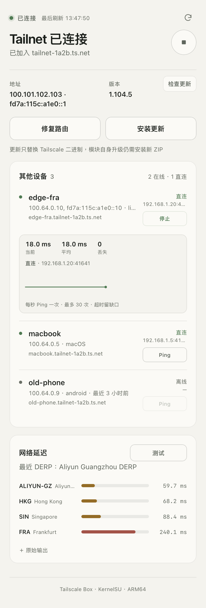

# Tailscale Box

用原生 `tailscale0` TUN 接入 Tailnet，不使用 Android VPNService。仅支持 ARM64。

<p align="center">
  
</p>

## 安装

Release 提供两种 ZIP，均可由 Magisk、KernelSU 或 APatch 直接安装（仅在KernelSU + Android 16 上进行测试）：

| 包 | 内容 | 安装后 |
| --- | --- | --- |
| `tailscale-box-版本-minimal-arm64.zip` | 模块与 WebUI，不含 Tailscale | 在 WebUI 安装 Tailscale，再启动并登录 |
| `tailscale-box-版本-bundled-arm64.zip` | 模块、WebUI 和官方 stable ARM64 二进制 | 重启服务后登录 |

安装前先停用 Tailscale App 的 VPN。

首次使用：安装 ZIP → 打开模块 WebUI → 安装/启动 Tailscale → 登录。模块自身升级需安装新 ZIP；minimal 升级会保留现有 Tailscale 二进制。卸载会保留 `/data/adb/tailscale-direct` 下的身份与配置。

## Taildrop 接收

模块启动后自动接收 Taildrop 文件，保存到 `/storage/emulated/0/Download/taildrop/`。

安装时会提前创建目录；若共享存储尚未就绪，接收器启动后每 5 秒重试创建，若创建失败可手动建文件夹。

在发送端选择设备，也可用 `tailscale file cp 文件 设备名:`。首次使用需在 Tailscale 管理控制台开启 Send Files。[官方说明](https://tailscale.com/kb/1106/taildrop)

## 网页

页面显示连接状态、Tailnet 地址、Peer 在线情况、直连/DERP/Peer relay，以及 `netcheck` 的 DERP 区域延迟。每台在线设备可单独 Ping：点击后立即出现探测状态，随后每秒采样一次，显示本次响应的实际路径。曲线保留最近 30 个真实样本，超时留缺口；延迟、平均值和丢失数仍按原始结果统计。网络延迟测试会立即显示计时，重测期间保留上一次结果。

登录流程：启动 → 登录 → 打开授权链接 → 在浏览器完成授权 → 返回刷新；路由未生效时点「修复路由」，授权链接最长约 60 秒返回。

## 命令行

Root shell：

```sh
/data/adb/modules/tailscale_direct/ctl.sh start
/data/adb/modules/tailscale_direct/ctl.sh login
/data/adb/modules/tailscale_direct/ctl.sh status
/data/adb/modules/tailscale_direct/ctl.sh repair
/data/adb/modules/tailscale_direct/ctl.sh ts ping 对端IP
/data/adb/modules/tailscale_direct/update.sh
```

## 路由与代理

模块只添加 priority 70、目标 `100.64.0.0/10` 与 `fd7a:115c:a1e0::/48` → table 52 的规则。登录固定 `accept-dns=false`、`accept-routes=false`、`netfilter-mode=off`，不修改系统 DNS、SELinux、fwmark、默认路由或 Box 链。

- **mihomo/box TPROXY**：确认规则旁路 Tailnet 网段，避免二次截获；只给 mihomo 配 DIRECT 不够。priority 70 通常早于 Box 的 100，以设备实际 `ip rule` 为准。
- **控制面代理**：需要时写入 `/data/adb/tailscale-direct/control-proxy`，内容为本地无认证 HTTP 代理，例如 `http://127.0.0.1:7890`，然后重启。它只代理控制面，不替代 P2P UDP。

## 更新与排错

Action 和 `update.sh` 从官方 stable API 下载 ARM64，校验 SHA256、测试候选二进制，再备份并替换。原本运行的服务会重启，原本停止的保持停止；新版本启动失败会回滚。备份在 `/data/adb/tailscale-direct/backup-*`，安装来源记录在 `installed-provenance.txt`。

- `ctl.sh diagnose`：状态、netcheck 和 daemon 日志。
- `ctl.sh network-diagnose 对端TailnetIP`：收集路由、UDP socket、连接状态和近期日志，并对指定设备做最多 25 秒探测；不修改路由或重启服务。
- 日志：`/data/adb/tailscale-direct/daemon.log`、`action.log`。
- 分享诊断前先遮蔽设备名、地址、授权链接和 `tailscaled.state`。

## 构建与发布

```sh
uv run --no-project python scripts/build.py --variant both
uv run --no-project python scripts/build.py --variant minimal
uv run --no-project python -m unittest discover -s tests
```

输出在 `dist/`，minimal 不含二进制。

GitHub Actions 只在 `module.prop` 的 `version` 或 `versionCode` 变化时构建。

## 限制

不支持自动子网路由、MagicDNS、Exit Node、手机网关或无限保活。

## 来源与许可

bundled 包使用官方 Linux 静态 Tailscale ARM64 发行归档，实际来源见包内 `PROVENANCE.txt`。Tailscale 及第三方组件许可证见 `LICENSE.tailscale`、`LICENSE.reference` 与上游发行内容。
